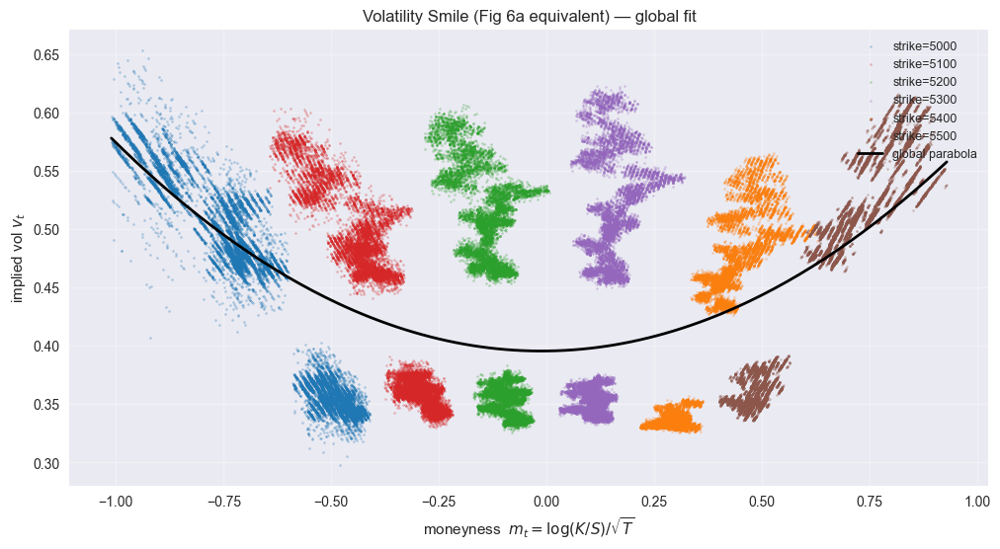
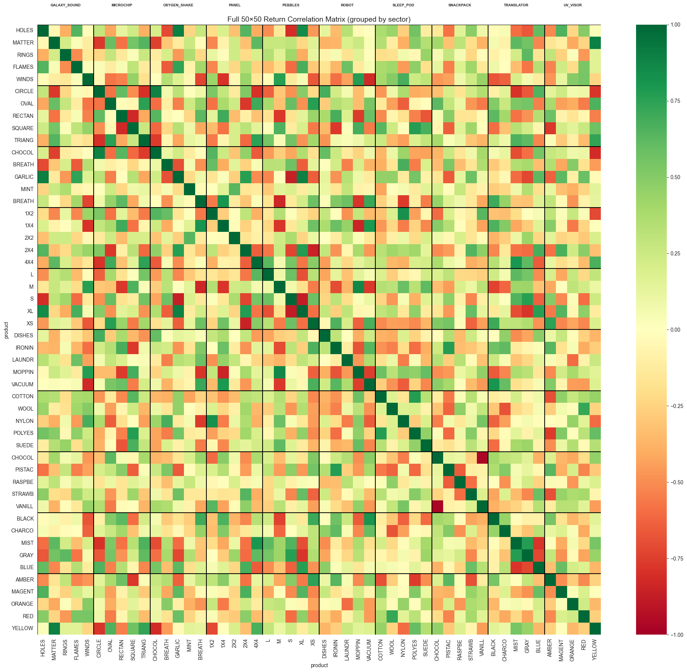

# IMC Prosperity 4: Algorithmic Trading Challenge (2026)

My algorithms and research for **IMC Prosperity 4**, IMC Trading's global trading competition. Over five rounds, a Python `Trader` bot trades a growing universe of products on a simulated exchange, under strict position limits. Alongside the algorithms there is a "manual" trading puzzle each round.

This edition builds on what I learned in [Prosperity 3](https://github.com/julesFrealle/prosperity3), where we finished 29th of 12,620 teams.

<p align="center">
  
  <br>
  <em>Left: implied-volatility smile of the VELVETFRUIT vouchers (Rounds 3–4). Right: return-correlation matrix of the 50 Round 5 products, grouped by family.</em>
</p>

## Strategies by round

### Rounds 1–2: market making and trend following · [`round_1_2.py`](algorithms/round_1_2.py)
| Product | Strategy |
|---|---|
| `ASH_COATED_OSMIUM` | Market making around an **EMA fair value** adjusted for **order-book imbalance**, with an inventory penalty. A light mean-reversion pull towards 10,000 is added, plus reversal signals from market trades (hits on the order-book wall, extreme prints) |
| `INTARIAN_PEPPER_ROOT` | Structural upward drift, so the bot **buys and holds up to the position limit**. Dual-EMA and trend-intercept guards stop it from buying into a crash, and it never sells |

### Round 3: options on a new underlying · [`round_3.py`](algorithms/round_3.py)
| Product | Strategy |
|---|---|
| `HYDROGEL_PACK`, `VELVETFRUIT_EXTRACT` | Aggressive taking against a fixed fair value, with **asymmetric buy/sell edges** calibrated on 3 days of data |
| `VEV_5000 … VEV_5500` vouchers (calls) | Near-the-money: fixed-fair taking at Level 1 and Level 2 of the book |
| `VEV_4000`, `VEV_4500` | Deep in the money: the **fair value is dynamic**, equal to `VFE_mid − K` (the premium is ≈ 0 with a std below 1) |
| `VEV_6000`, `VEV_6500` | Always quoted 0/1, so any round trip loses money; deliberately excluded |

### Round 4: counterparty signals · [`round_4.py`](algorithms/round_4.py)
- The Round 3 mean-reversion core, with **reference prices blended through an EMA** to follow slow drift.
- A **trader-ID overlay**: Round 4 made counterparty IDs visible in market trades. Trades by informed bots (`Mark 14`, `Mark 01`) are **followed** and trades by toxic or aggressive ones (`Mark 38`, `Mark 55`) are **faded**. The signal is instantaneous and executed only with passive orders, so it never overrides the core logic.
- Research: fitting the volatility smile, IV residuals and **IV scalping** ([`vouchers_iv_scalping.ipynb`](research/vouchers_iv_scalping.ipynb)).

### Round 5: 50 products in 10 families · [`round_5_final.py`](algorithms/round_5_final.py)
| Family | Strategy |
|---|---|
| Galaxy Sounds, Pebbles, Sleep Pods, Microchips | **Fourier-series fair value**: each product's price path is fitted with a truncated Fourier series (period 30,000 ticks). The bot **infers the current phase live** by matching observed mids, then trades on `fair − mid + λ·d(fair)/dt` |
| Oxygen Shakes, Panels, Translators, UV Visors | **Single-mode Fourier forecasts**: trade the expected move of chosen harmonics over a short horizon |
| Snackpacks | **Mean reversion** of each product against its family cluster (z-score entry/exit) |
| Robots | **Basket z-score** strategy, with passive overlay orders |

Each family was first prototyped as a standalone bot in [`round_5_modules/`](algorithms/round_5_modules), then merged into the final `Trader`.

### Manual rounds · [`manual/`](manual)
- **Reserve-price auction (R3):** simulates the bids of thousands of other players to choose two bids that maximise expected profit.
- **News-driven portfolio (Ashflow):** maps news sentiment to expected returns and optimises weights under a **quadratic fee**, then stress-tests the result with Monte Carlo.
- **Ignith market:** Monte Carlo PnL distributions for each good and for the whole portfolio.

## Repository structure

```
├── algorithms/
│   ├── round_1_2.py            # final bot, rounds 1–2
│   ├── round_3.py              # final bot, round 3
│   ├── round_4.py              # final bot, round 4
│   ├── round_5_final.py        # final bot, round 5 (all 50 products)
│   └── round_5_modules/        # per-family prototypes merged into round_5_final.py
├── research/                   # notebooks: data exploration, vouchers / IV, 50-product analysis
├── manual/                     # manual-round optimisers & simulators
└── assets/
```

## Running a backtest

The bots import `datamodel` from the official Prosperity starter kit and can be run with any community Prosperity backtester. Market data is not stored here to keep the repo light. Download it from the Prosperity platform into a `DATA_DIR/` folder (`prices_round_X_day_Y.csv`, `trades_round_X_day_Y.csv`), which the research notebooks read from.

## Tech stack

`Python` · `NumPy` · `pandas` · `SciPy` · `Matplotlib` · order-book microstructure · options / implied volatility · Fourier analysis · Monte Carlo
